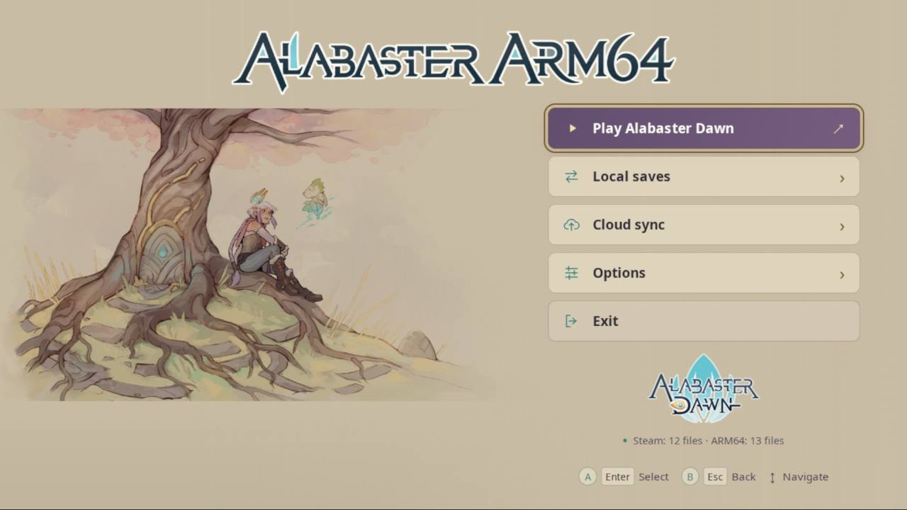
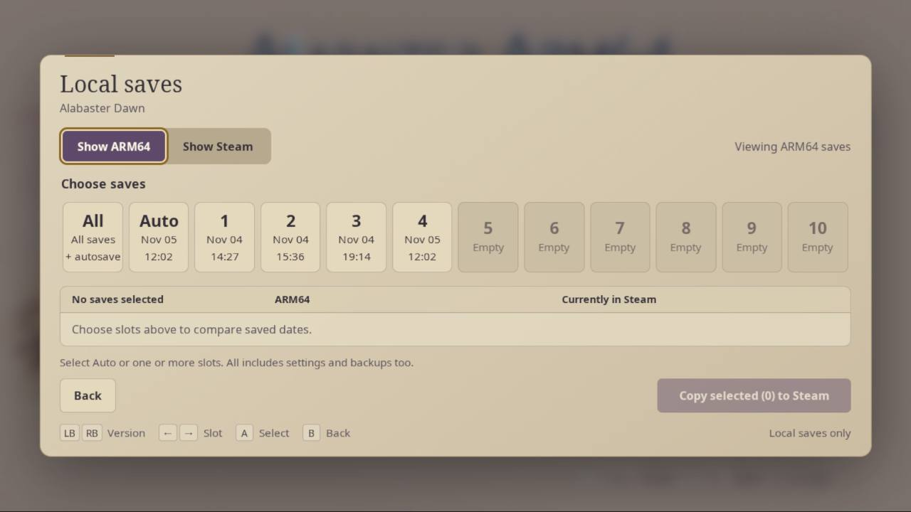
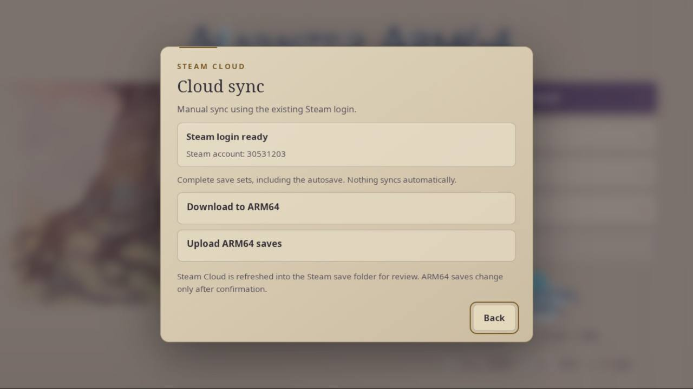
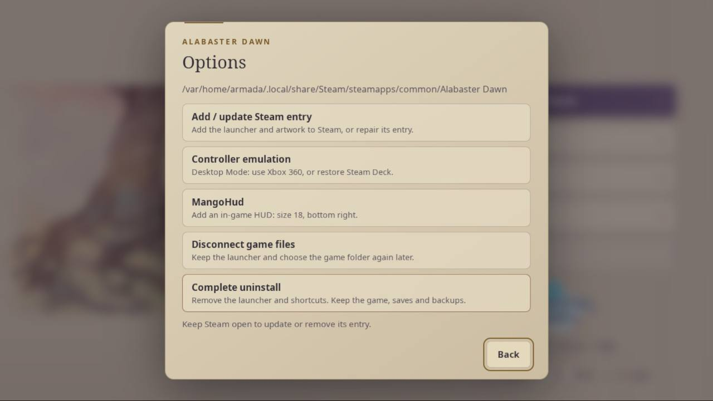
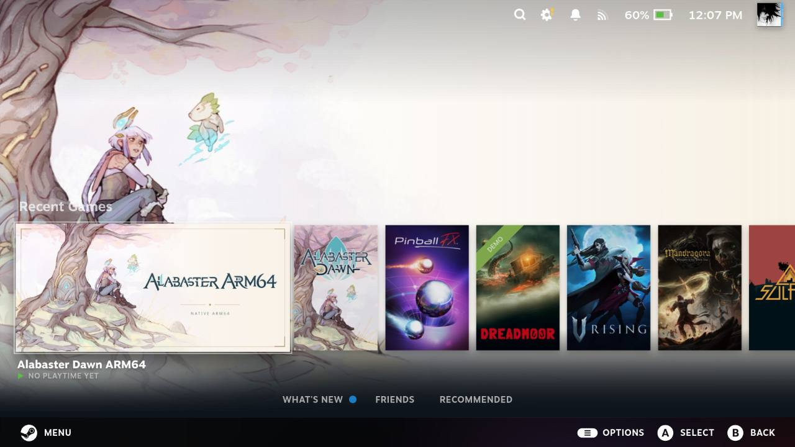

# Alabaster ARM64

Run **Alabaster Dawn natively on Armada Linux ARM64**, without Proton. This unofficial launcher uses the installed game's JavaScript/WebGL files with NW.js ARM64.

Inspired by the Android wrappers [alabaster-android](https://github.com/moronigranja/alabaster-android) and [AlabasterDawnBox](https://github.com/AerithMetiq/AlabasterDawnBox).

## Install

1. Switch to **Desktop Mode**, open Steam and install the full game's **Linux version**. Installing the game in Gaming Mode also works; open Steam in Desktop Mode before continuing.
2. Download and extract **Alabaster-Dawn-Setup-linux-arm64.tar.gz** from [Releases](https://github.com/mrdidit/alabaster-arm64/releases).
3. Open **Alabaster-Dawn-Setup.arm64**. Setup and the launcher open maximized. If Steam is closed, choose **Start Steam**, **Continue without Steam** or **Cancel**. Setup downloads and checks the required runtime automatically.
4. Choose **Install**, confirm the detected game folder, then **Play Alabaster Dawn**.

Keep Steam open to add the ARM64 library entry and artwork. Setup also creates desktop and application-menu entries. Installation can continue without Steam; follow the warning and use **Options → Add / update Steam entry** once Steam is open. After setup, play from either mode.

Or run in a desktop terminal, or over SSH as the same user signed into the device's desktop:

```sh
curl -fsSL https://github.com/mrdidit/alabaster-arm64/releases/download/v0.5.2/install.sh | bash
```

This verifies the download and opens the same setup app. Over SSH, setup appears on the device's desktop; keep the terminal connected until setup closes. Automatic discovery supports Armada's KDE desktop and common Linux desktops with X11/Xwayland. If no suitable session is found, run the command in a desktop terminal. No `sudo` is needed.

## Features

- Controller, keyboard and touch navigation. In **Desktop Mode**, select **Xbox 360** in **Options → Controller emulation** and authorize the change if it is not already set. This enables controller input in both the launcher and game; the same option can restore Steam Deck emulation.
- Local save copying in either direction: autosave, individual slots, multiple selections or All, with dates and backups.
- Manual **Steam Cloud download and upload** using the existing Steam login.
- In **Gaming Mode**, Steam Deck and Xbox 360 emulation both work. Change it through **Armada Control**; the launcher's emulation controls are for Desktop Mode. Emulation applies across the device and persists after reboot.
- **Options → MangoHud** adds an in-game performance HUD to the Steam launch command, with size 18 at the bottom right. This addresses missing GPU usage in Steam's performance overlay for this game. **Disable the performance overlay in Steam QAM** to avoid two HUDs; relaunch after applying.
- Disconnect game files or uninstall the launcher from Options. Original game files, saves and backups are kept.

## Saves and game files

Use the existing Steam game installation and signed-in Steam client for Cloud access. These are the current integration choices and may change in a future release. An owned copy is required; no playable game files are bundled.

Cloud actions are manual and transfer the complete save set. Keep Steam signed in and the original game closed. **Local saves** only copies between local folders; it does not upload to Cloud. Pending local copies can then be uploaded through **Cloud sync → Upload ARM64 saves**.

**v0.5.2 is a testing prerelease.** Current target: full game **0.2.0-9**, with **NW.js 0.119.2 ARM64**. See [validation and build notes](DEVELOPMENT.md) for tested scope and remaining checks, and [credits](THIRD_PARTY.md) for upstream projects.

## Screenshots










